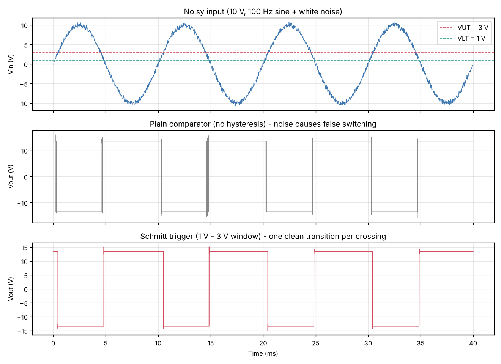
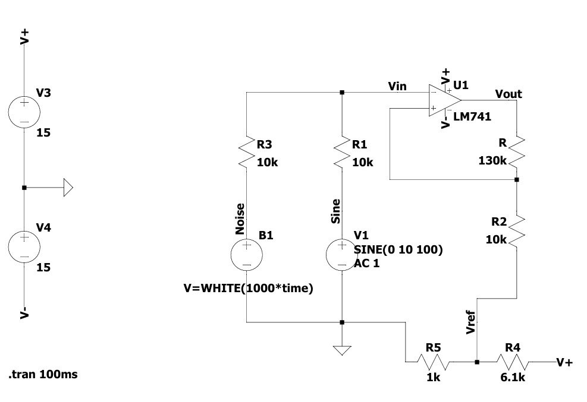
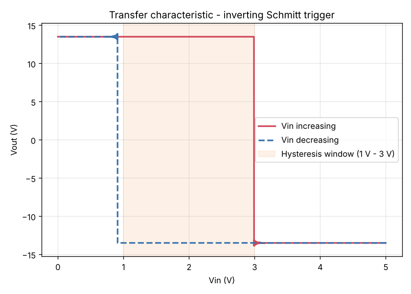
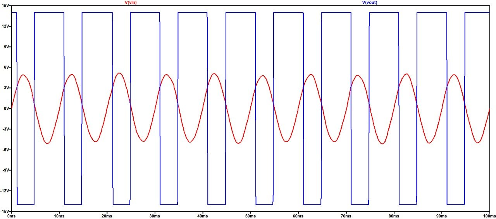
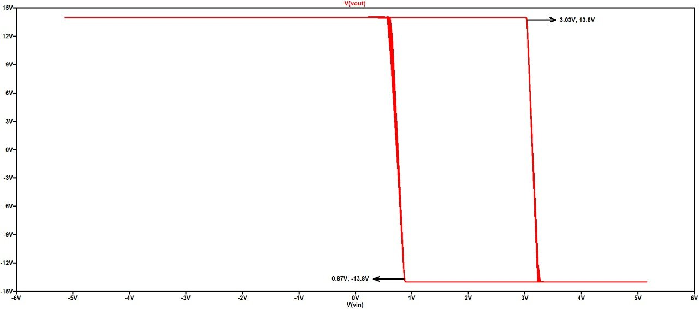
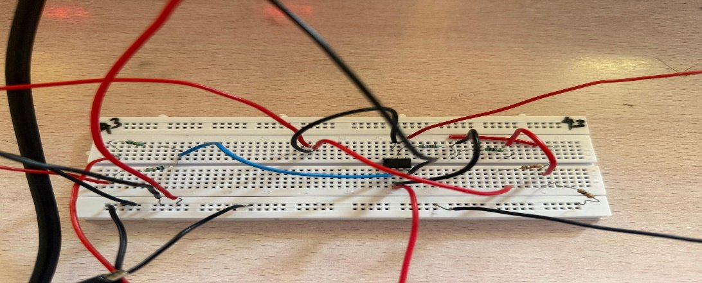
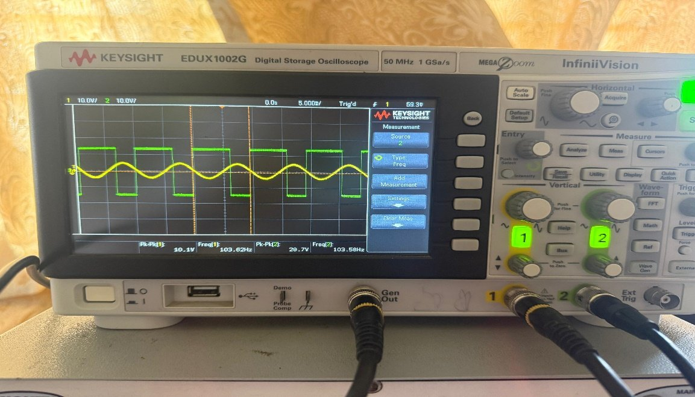
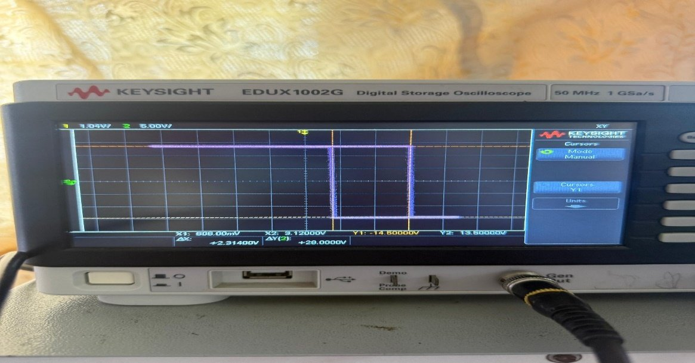
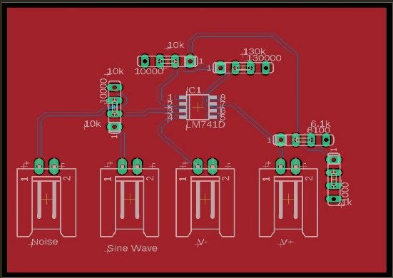
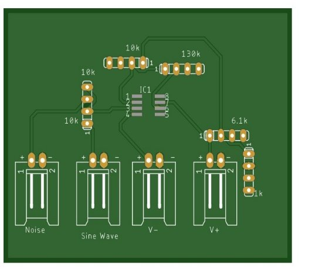

<h1 align="center">Inverting Schmitt Trigger: 1 V – 3 V Hysteresis Window</h1>

<p align="center">
  An op-amp comparator with a precise 1 V – 3 V hysteresis window that gives a clean output from a noisy input. Designed by hand, simulated in LTspice and ngspice, built on a breadboard and laid out as a PCB.
</p>

<p align="center">
  
  
  
  
  
</p>

<p align="center">
  
</p>

---

## Problem

A plain comparator switches every time a noisy signal crosses its threshold, so its output **chatters** (rapid false transitions). A Schmitt trigger adds **hysteresis**: two separate thresholds, so the output changes only once per real crossing.

**Specification:** an inverting Schmitt trigger with

- **Upper threshold (VUT) = 3 V**: input above 3 V → output switches **LOW**
- **Lower threshold (VLT) = 1 V**: input below 1 V → output switches **HIGH**

## Circuit Design

<p align="center">
  
</p>

**Given:** ±VCC = 15 V, so ±Vsat ≈ 0.9 × 15 = ±13.5 V

| Step | Equation | Result |
|---|---|---|
| Hysteresis width | VH = VUT − VLT | **2 V** |
| Feedback ratio | VH = 2 · R2/(R + R2) · Vsat → R2/(R + R2) = 0.074 | R = 12.5 · R2 |
| Resistor choice | R2 = 10 kΩ → R = 125 kΩ | **130 kΩ** (nearest E24 value) |
| Centre voltage | VCTR = (VUT + VLT)/2 | **2 V** |
| Reference | Vref = VCTR · (R + R2)/R | **≈ 2.16 V** |
| Reference divider | 15 V · R5/(R4 + R5), with R4 = 6.1 kΩ, R5 = 1 kΩ | **2.11 V** |

The lab bench had only two supplies, so the reference voltage comes from a **resistive divider on the +15 V rail** instead of a third supply.

### Bill of Materials

| Component | Value | Qty |
|---|---|:---:|
| Op-amp | LM741 | 1 |
| Resistor R1 (input) | 10 kΩ | 1 |
| Resistor R2 (feedback to Vref) | 10 kΩ | 1 |
| Resistor R (positive feedback) | 130 kΩ | 1 |
| Resistor R4 / R5 (Vref divider) | 6.1 kΩ / 1 kΩ | 1 / 1 |
| Dual DC supply | ±15 V | 1 |
| Function generator, DSO | — | 1 |

## Simulation Results

### ngspice (included in this repository)

| Transfer characteristic (Vout vs Vin) | Measured thresholds |
|:---:|:---|
|  | **VUT ≈ 2.99 V**<br>**VLT ≈ 0.91 V**<br><br>With the same noisy input, the plain comparator switched **32 times** in 40 ms. The Schmitt trigger switched **8 times**, exactly once per real crossing. |

### LTspice

| Noisy input and output | Hysteresis window |
|:---:|:---:|
|  |  |

## Hardware Implementation

| Breadboard prototype | Input / output on DSO | Hysteresis (X-Y mode) on DSO |
|:---:|:---:|:---:|
|  |  |  |

### PCB Design (Eagle)

| Layout | 3D view |
|:---:|:---:|
|  |  |

## Run the Simulation

Install the free [ngspice](https://ngspice.sourceforge.io/) simulator, then:

```bash
cd simulation
ngspice -b schmitt_trigger.cir     # transient: noisy sine, comparator vs Schmitt trigger
ngspice -b hysteresis_loop.cir     # Vout vs Vin sweep; prints VUT and VLT
python plot_results.py             # regenerate the plots in docs/images/
```

## Challenges and Solutions

| Challenge | Solution |
|---|---|
| Only two supplies on the bench; the design needed a third (Vref) | Made Vref ≈ 2.11 V with an R4/R5 divider on +15 V |
| The exact calculated resistor (125 kΩ) is not a standard value | Used the nearest E24 value (130 kΩ) and recalculated the thresholds |
| Lab function generator could not reproduce the simulated white noise | Tested with several input signals to confirm stable switching |

## Repository Structure

```
schmitt-trigger-hysteresis-window/
├── simulation/
│   ├── schmitt_trigger.cir     # ngspice: noisy-input transient (vs plain comparator)
│   ├── hysteresis_loop.cir     # ngspice: transfer characteristic and thresholds
│   └── plot_results.py         # Plots the simulation output
└── docs/
    └── images/                 # Schematic, waveforms, hardware and PCB images
```

## Applications

Switch debouncing · noisy sensor thresholding · zero-crossing detection · square-wave generation · ADC front-end conditioning

## Author

**Sujith Krishna P G**

<a href="https://github.com/SujithPG-coder"></a>
<a href="https://www.linkedin.com/in/sujithkrishnapg/"></a>

## License

This project is licensed under the [MIT License](LICENSE).
